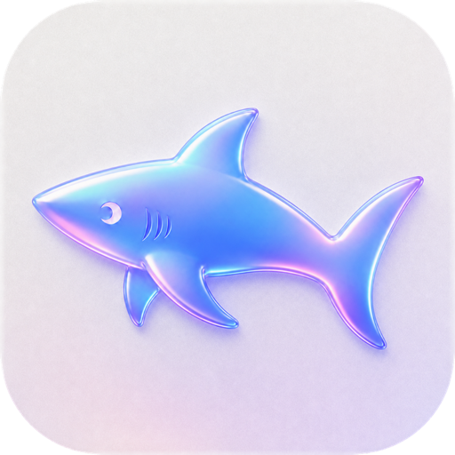
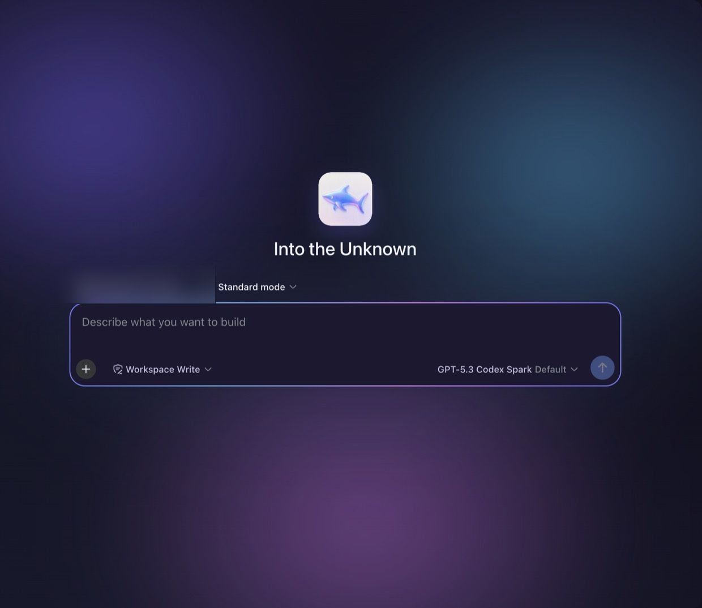
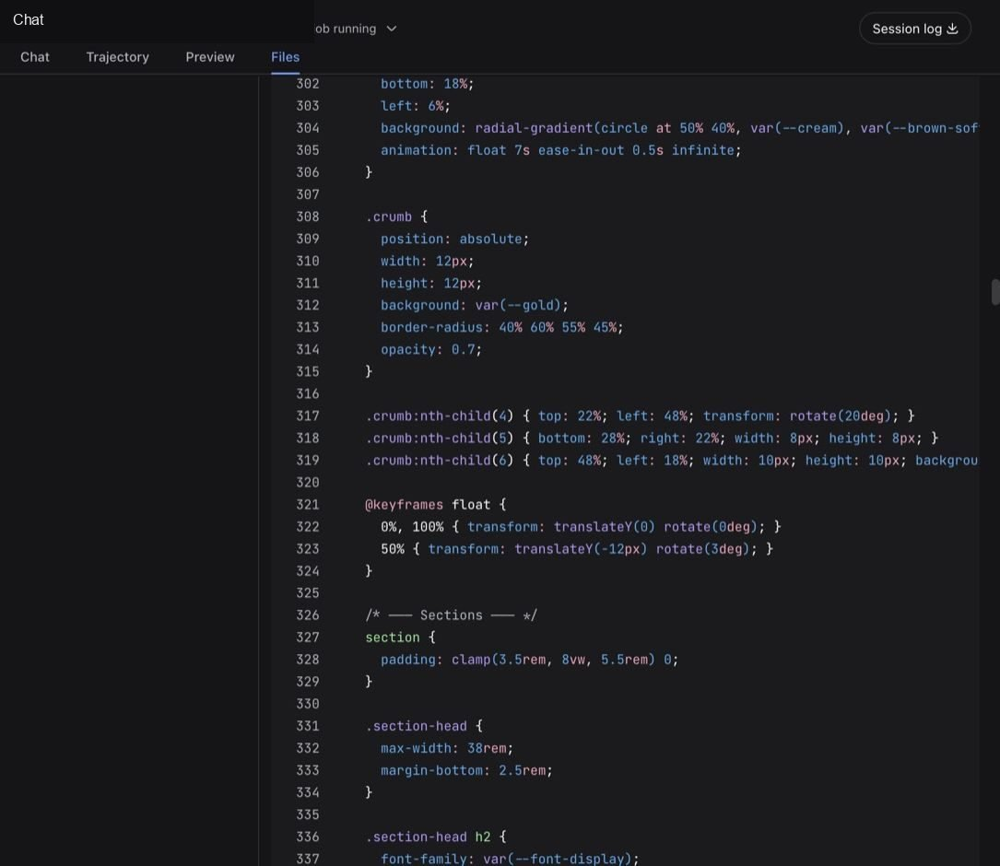
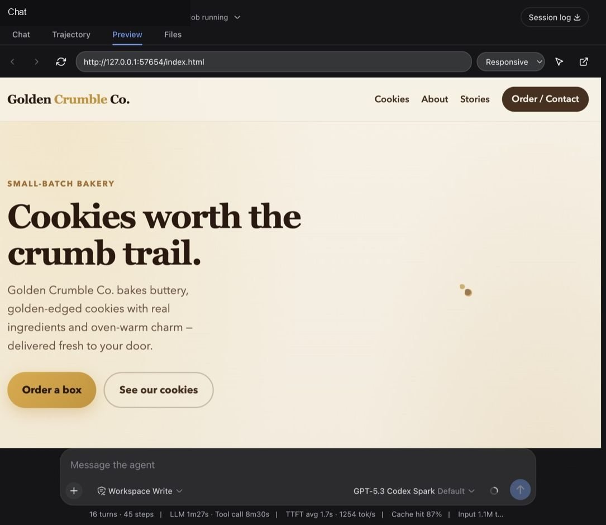
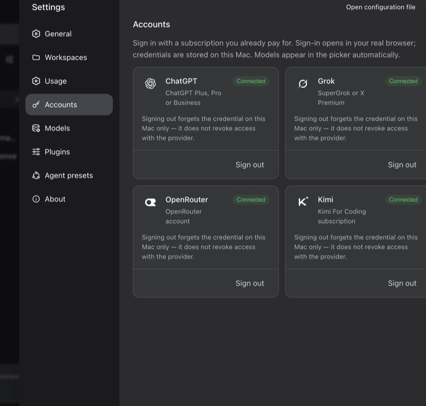

<p align="center">
  
</p>

<h1 align="center">DSH PRO</h1>

<p align="center">
  A desktop app for <a href="https://github.com/deepseek-ai/deepseek-harness">DeepSeek Harness</a>.<br>
  Open it, sign in, and start building. No terminal required to use the app.
</p>

<p align="center">
  <a href="https://dsh.bytefwd.com/">Website</a>
  &nbsp;·&nbsp;
  <a href="https://dsh.bytefwd.com/download/">Download</a>
</p>

<p align="center">
  
</p>

Not affiliated with or endorsed by DeepSeek.

## Features

- Sign in to ChatGPT, Grok, OpenRouter, and Kimi. Credentials stay on your computer.
- Start a chat in a workspace and tell it what you want to build.
- Edit project files without leaving the app.
- Preview a local page in the same window.
- Use the built-in terminal when you need a command.
- See recorded usage from this app.

<p align="center">
  
  
  
</p>

## Getting started

You need Node `^22.19.0` or `>=24`, and pnpm 11.7.

```bash
pnpm install
pnpm start
```

`pnpm start` opens the desktop app from this source tree.

To build installers:

```bash
pnpm run pack
```

That builds the Mac app. `pnpm run pack:linux` builds the Linux app. Finished installers land in `release/`.

If you only want to use the app, download it from [dsh.bytefwd.com/download](https://dsh.bytefwd.com/download/).

## Usage

1. Open the app.
2. Go to Settings, then Accounts, and sign in.
3. Choose a workspace, or add one.
4. Type what you want to build and send it.

The Files and Preview buttons open those tools for the workspace you are in. Terminal opens the command panel.

## How it works

This repository is the desktop shell, not a copy of DeepSeek Harness. The harness is installed from the published `@deepseek-ai/*` packages.

| Folder | What it is |
| --- | --- |
| `shell/` | The Electron app: window, menu, and startup |
| `plugins/` | Desktop features such as accounts, files, preview, and the terminal |
| `scripts/` | Build and test commands |
| `build/` | App icon and Mac signing settings |
| `assets/` | Images used in this README |

## Configuration

Sign-in happens inside the app. Do not put API keys in this repository.

Signing and notarization credentials also stay on your machine. They are not stored here.

## License

MIT. Third-party notices are in [THIRD_PARTY_NOTICES.md](THIRD_PARTY_NOTICES.md).
